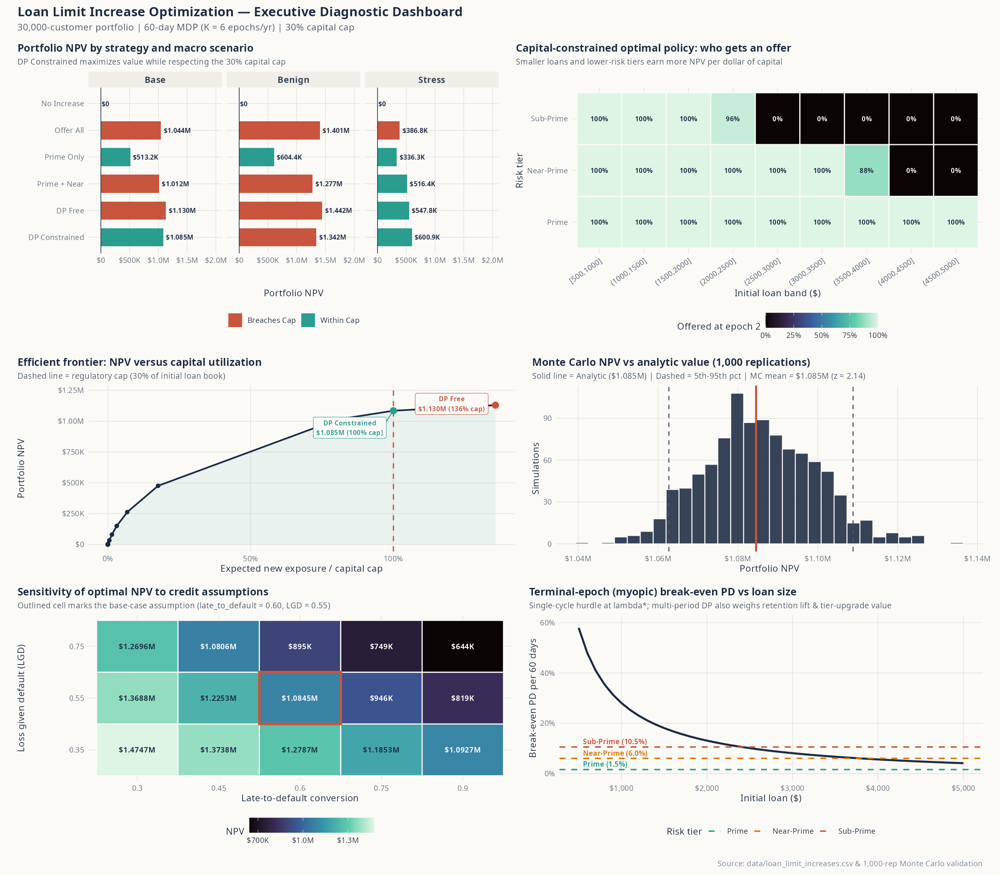

# Credit Limit Increase Optimization

An end-to-end credit risk and limit strategy framework for consumer lending portfolios. This project solves the problem of how to systematically allocate loan limit increase offers across 30,000 borrower accounts to maximize portfolio Net Present Value (NPV) while strictly adhering to capital exposure limits and managing default risk.

---

## Executive Summary

Extending credit limit increases without risk targeting either triggers excessive default losses or breaches portfolio capital constraints. Conversely, lending strictly to prime borrowers leaves substantial capital idle and halves potential revenue.

By framing credit line management as a multi-period decision problem under a portfolio capital cap, this framework derives an optimal, data-driven targeting policy:

* **+$1,084,533 Portfolio NPV** ($36.15 per customer) over a 1-year horizon.
* **100% Capital Utilization** without exceeding the 30% portfolio exposure cap ($24.77M).
* **Controlled Default Rate:** 4.79% per accepted increase (down from 5.7% under blanket offers).
* **+111% Lift over Conservative Strategy:** More than double the net profit of a "Prime Only" strategy ($513K).

---

## Strategy Comparison & Portfolio Impact

| Strategy | Portfolio NPV | Gross Revenue | Expected Credit Loss | Capital Cap Utilization | Status | Default / Accepted |
| :--- | :---: | :---: | :---: | :---: | :---: |
| **No Increase** | $0 | $0 | $0 | 0.0% | Compliant | — |
| **Prime Only** | $513,224 | $597,721 | $84,497 | 44.8% | Compliant | 1.5% |
| **Offer All** | $1,043,611 | $2,179,254 | $1,135,643 | 162.1% | **Breached (+62%)** | 5.7% |
| **Optimal Policy** | **$1,084,533** | **$1,611,601** | **$527,068** | **100.0%** | **Compliant** | **4.8%** |
| *Tiered Step Sizing* | *$1,144,109* | *$1,537,865* | *$393,756* | *100.0%* | *Compliant* | *4.7%* |

### Why Simple Heuristics Fail
1. **The "Offer All" Trap:** Offering increases to all eligible borrowers appears to generate high gross revenue ($2.18M), but severe defaults on large, high-risk loans wipe out over $1.13M in credit losses while blowing through the capital cap by 62%.
2. **The "Prime Only" Opportunity Cost:** A purely conservative strategy avoids credit losses but wastes 55% of the allowable lending capacity, leaving over $570,000 in net value on the table.
3. **The Optimal Balance:** Offers are segmented by both risk tier and loan balance:
   * **Prime Accounts:** Eligible for increases across all loan sizes ($500 – $5,000).
   * **Near-Prime Accounts:** Fully eligible up to $3,500; selectively offered between $3,500 – $4,000; capped above $4,000.
   * **Sub-Prime Accounts:** Capped at $2,500, capturing profitable small-ticket volume while shielding the balance sheet from large loss severity.

---

## Strategy Dashboard



*The dashboard highlights (top-to-bottom, left-to-right): Strategy NPV comparisons, loan-size cutoff policy map, risk-return capital frontiers, 1,000-iteration Monte Carlo distribution, sensitivity surface, and break-even recovery economics.*

---

## Key Features

* **Dynamic Multi-Period Decision Engine:** Models customer repayment performance, limit acceptance rates, and tier transitions across 60-day review cycles.
* **Capital Constraint Balancing:** Automatically prices the opportunity cost of capital to find the exact boundary where incremental exposure hits the portfolio budget.
* **Macroeconomic Stress Testing:** Evaluates policy performance under baseline, benign, and stress conditions (elevated unemployment and interest rates), showing how offer volumes automatically contract to protect capital.
* **Monte Carlo Validation:** Validates expected outcomes across 1,000 simulation runs ($1.085M simulated mean vs. $1.084M analytical expectation), confirming 0% risk of portfolio-level loss (5% CVaR at $1.058M).
* **Modern R & Tidyverse Stack:** Clean, reproducible pipeline built with modern R (`dplyr`, `purrr`, `yardstick`, `scales`, and `ggplot2`).

---

## Project Structure

```text
├── data/
│   └── loan_limit_increases.csv     # 30,000 customer portfolio records
├── figures/
│   ├── r_dashboard.png              # 6-panel executive summary dashboard
│   ├── r_01_strategy_npv.png        # Strategy NPV comparison chart
│   ├── r_02_policy_map.png          # Offer decision rules across loan sizes
│   ├── r_03_frontier.png            # Capital utilization vs. net return
│   ├── r_04_monte_carlo.png         # Simulation distribution (1,000 runs)
│   ├── r_05_sensitivity.png         # Stress grid across default & recovery rates
│   └── r_06_breakeven.png           # Unit economics break-even analysis
├── outputs/
│   ├── strategy_results.csv         # Summary metrics across all tested strategies
│   ├── validation.csv               # Analytical vs. simulation verification table
│   ├── sensitivity.csv              # Scenario stress testing results
│   └── policy_summary_by_tier_loan.csv # Granular offer allocation by loan bucket
├── loan_limit_optimization.ipynb    # Complete reproducible R analysis notebook
└── README.md
```

---

## Getting Started

### Prerequisites

* R (>= 4.2)
* Jupyter Notebook with the [Ark R kernel](https://github.com/posit-dev/ark) or standard IRkernel
* R packages: `tidyverse`, `scales`, `gridExtra`, `matrixStats`, `knitr`

### Running the Notebook

To execute the notebook and regenerate all results, figures, and CSV outputs:

```bash
jupyter nbconvert --to notebook --execute --inplace loan_limit_optimization.ipynb
```
